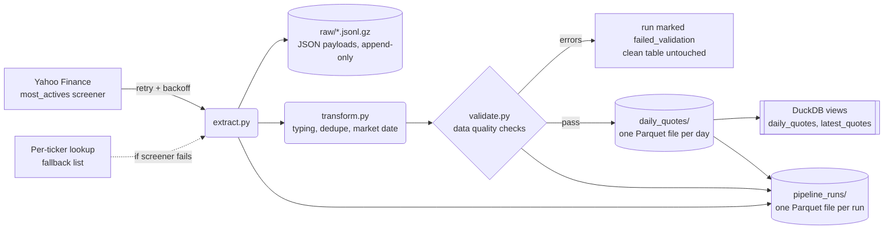

# Most-Active Stocks ELT Pipeline

[](https://github.com/jessecdeluna/stock-pipeline/actions/workflows/ci.yml)
[](https://github.com/jessecdeluna/stock-pipeline/actions/workflows/daily.yml)

A daily batch pipeline that captures the most actively traded US stocks from Yahoo Finance, validates the data, and builds up a history of daily Parquet files that you query with SQL through DuckDB.

It started as a class project, a single Jupyter notebook that scraped CNN and Yahoo with Selenium and BeautifulSoup and wrote a SQLite table. This repo rebuilds it as a production-style pipeline. The original is preserved in [`legacy/`](legacy/) for comparison.

## Architecture



The warehouse is plain files. DuckDB is only the query engine: it reads the files directly, so there is no database file to keep in sync.

```
warehouse/
  daily_quotes/2026-10-27.parquet          clean rows, one file per trading day (~3 KB)
  pipeline_runs/<time>_<run_id>.parquet    one row per run: the audit log
  raw/<time>_<run_id>.jsonl.gz             every API payload exactly as received
  latest.csv                               the newest day, in the original stocks.txt format
```

| Layer | SQL name | Files | Purpose |
|---|---|---|---|
| Raw | `raw_quotes` | `raw/` | Every payload exactly as received, for replay and debugging |
| Clean | `daily_quotes` | `daily_quotes/` | Typed rows, one per ticker per trading day, full history |
| Serving | `latest_quotes` | (view) | Most recent snapshot, ranked |
| Ops | `pipeline_runs` | `pipeline_runs/` | Status, data source, row counts, and quality issues for every run |

Each run replaces only its own day's file (written to a temp file, then renamed), so reruns are idempotent. The same layout works unchanged in cloud object storage such as Amazon S3.

## What changed from v1

| Problem in the notebook | Fix |
|---|---|
| CNN Selenium scrape failed on every run and **silently** used a hardcoded ticker list | Yahoo screener API returns tickers and stats in one call; any fallback is logged and recorded as `source='fallback'` |
| Yahoo HTML parsing broke whenever the page markup changed | Structured JSON via `yfinance`, with field mapping for both payload shapes |
| `DROP TABLE` on every run destroyed all history | One file per trading day, replaced atomically: reruns are idempotent and history accumulates |
| One binary database file, rewritten every day | Small, standard Parquet files: readable by any tool, diff-friendly in git, ready for cloud storage |
| No retries | Exponential backoff on every network call |
| No data validation | Quality checks (row count, uniqueness, ticker format, positive prices, completeness, stale quotes) block or flag bad batches |
| Ran only when someone opened the notebook | Runs automatically every weekday on GitHub Actions |
| Dates were never stored | Each row is stamped with the **New York trading date** from the quote timestamp |
| One 400-line notebook cell | Separate extract / transform / validate / load modules, a CLI, and config via environment variables |
| No tests | 26 pytest tests with Yahoo mocked, run in GitHub Actions CI with ruff linting |

## Quickstart

```bash
python -m venv .venv
.venv\Scripts\activate          # Windows  (macOS/Linux: source .venv/bin/activate)
pip install -e ".[dev]"

pytest                           # run the test suite (no network needed)
stock-pipeline                   # run the pipeline once -> data/warehouse/
stock-pipeline --export-csv stocks.txt   # also write the original stocks.txt format
```

Query the history the daily job has committed to `warehouse/` (run `git pull` first to get the newest days):

```bash
stock-query                                        # today's 25 stocks
stock-query "SELECT snapshot_date, count(*) FROM daily_quotes GROUP BY 1 ORDER BY 1"
stock-query --file sql/analysis.sql                # every example query
stock-query --warehouse data/warehouse             # your own local runs instead
```

Import the data from the original notebook (one time):

```bash
python scripts/backfill_legacy.py legacy/StocksDatabase.db --as-of 2026-10-09 --warehouse warehouse
```

### Scheduled runs

[`.github/workflows/daily.yml`](.github/workflows/daily.yml) runs the pipeline every weekday after the market close (21:37 UTC). It commits the new day's files to [`warehouse/`](warehouse/), so the history builds up in the repo, and writes the run status and the day's snapshot to the job summary. [`warehouse/latest.csv`](warehouse/latest.csv) always holds the most recent snapshot. You can also start a run manually from the Actions tab with **Run workflow**.

### Docker

```bash
docker build -t stock-pipeline .
docker run --rm -v "$(pwd)/data:/data" stock-pipeline
```

## Configuration

| Variable | Default | Meaning |
|---|---|---|
| `STOCKS_WAREHOUSE_DIR` | `data/warehouse` | Warehouse folder (the daily job uses `warehouse`) |
| `STOCKS_SCREENER` | `most_actives` | Any Yahoo predefined screener (`day_gainers`, `day_losers`, …) |
| `STOCKS_TOP_N` | `25` | How many stocks to capture |
| `STOCKS_MIN_ROWS` | `5` | Fewer rows than this fails validation |
| `STOCKS_MAX_RETRIES` | `3` | Attempts per network call |
| `STOCKS_FALLBACK_TICKERS` | 10 large caps | Comma-separated list used if the screener is down |

## Data quality rules

| Check | Severity |
|---|---|
| At least `STOCKS_MIN_ROWS` rows | error |
| Tickers unique and correctly formatted | error |
| Open price > 0 | error |
| Average volume ≥ 0 | error |
| ≤ 50% of rows missing open price | error |
| Individual missing open price | warning |
| P/E outside (0, 10,000) | warning |
| Ticker's last quote is older than the batch date (`stale_quote`) | warning |

A missing P/E is valid: companies with negative trailing earnings (e.g. INTC) don't have one, so it's stored as NULL rather than treated as an error.

## Roadmap

- [x] Stabilize extraction, add retries and logging
- [x] Modular ELT structure, raw and clean layers, idempotent loads
- [x] Data quality checks, tests, CI, Docker
- [x] Daily schedule after market close (GitHub Actions cron)
- [ ] Move orchestration to Dagster or Airflow
- [ ] dbt models on top of `daily_quotes` (ticker dimension, rolling volume metrics)
- [x] Parquet file storage (v0.3; existing history migrated automatically)
- [ ] Move the Parquet files to Amazon S3, query with Athena
- [ ] Dashboard (Streamlit or Evidence)
